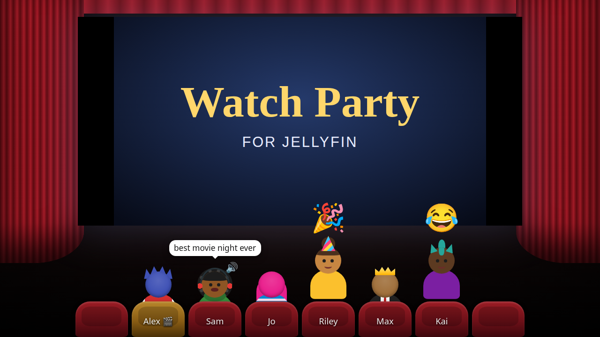
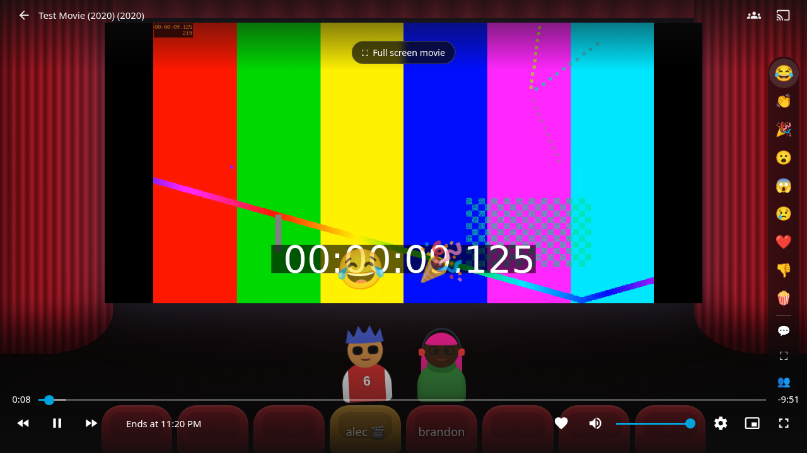
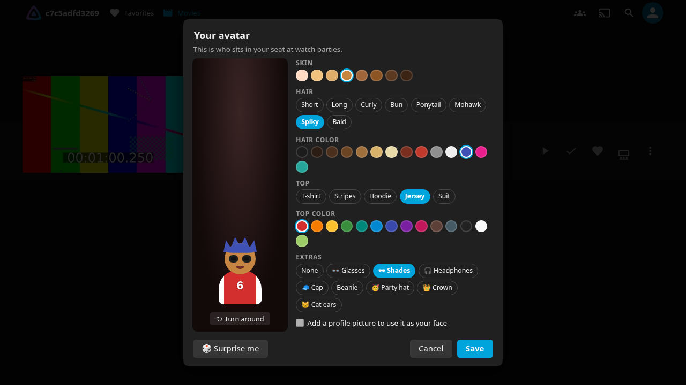
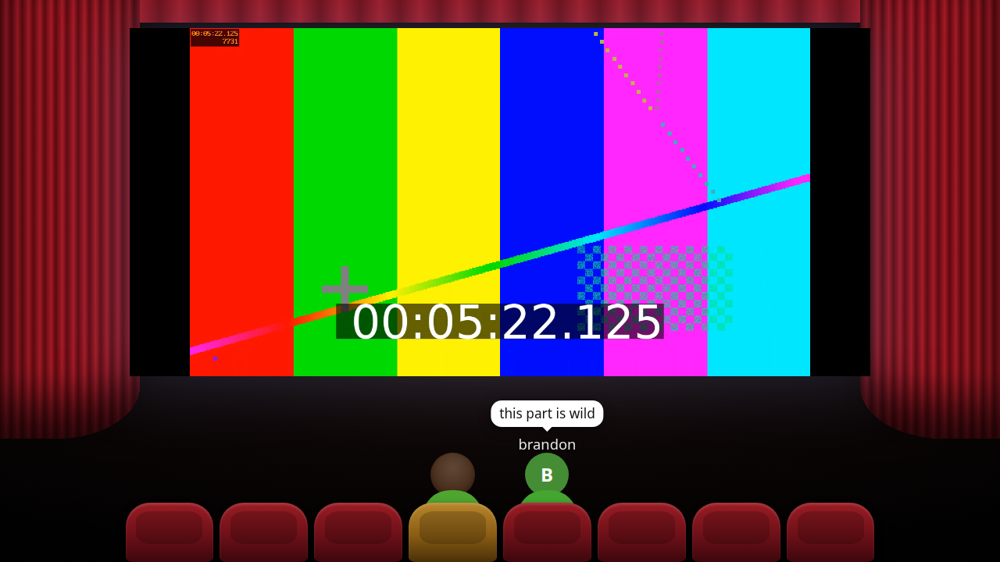
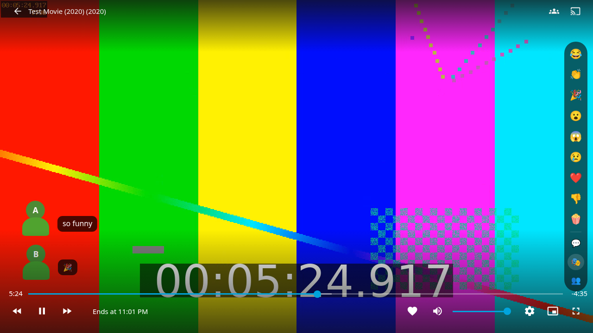

# Watch Party for Jellyfin

Watch movies and shows with friends in sync, like the Xbox 360 watch parties. Everyone's avatar sits in a virtual theater in front of the screen. React, chat and talk while you watch. The host has the remote and everyone else follows along.

## Features

- **Synced playback.** Start a party from the 👥 button on any movie or episode. Invite friends, and they get a pop-up invite in the web client. The host's play, pause, seek and next episode are mirrored for everyone. A guest who drifts out of step is caught up automatically.
- **Virtual theater.**
  - The movie plays on a screen between red curtains, with up to 8 seats in front.
  - Everyone's avatar sits in a seat, seen from behind. When someone reacts (😂 👏 🎉 😮 😱 😢 ❤️ 👎 🍿), their avatar stands up, turns around and acts it out.
  - Chat shows as speech bubbles, and the house lights come up when the host pauses.
  - **⛶ Full screen movie** (or the `T` key) hides the theater; avatars then slide in from the corner.
- **Custom avatars.**
  - Pick skin tone, hairstyle and hair color, a top and its color, and extras like glasses, headphones, a party hat or a crown.
  - Use the cartoon face or your profile picture.
  - 🎲 *Surprise me* picks a random look.
- **Voice chat** in the browser. Your avatar's mouth moves while you talk, and the movie volume dips while someone else is talking.
- **Party controls.**
  - Guests can ✋ ask the host to pause, and the host can pass the remote to someone else.
  - Stepping away marks you "BRB", and **Rejoin** catches you up. When the host stops, everyone gets an intermission.
- **Play on any device.** The party can drive another of your devices, such as a TV app: accept the invite on your phone and watch on the TV. Any Jellyfin app that supports remote control follows the playback. The theater, reactions, chat and voice are web-client only.

| | |
|---|---|
|  |  |
|  |  |

## Install

Requires **Jellyfin 12.x**.

1. In Jellyfin, open **Dashboard → Plugins → Repositories (Catalog settings)** and add:

       https://raw.githubusercontent.com/ablatnick/jellyfin-plugin-watchparty360/main/manifest.json

2. Open the **Catalog**, find **Watch Party** under *General*, and install it.
3. Restart Jellyfin, then refresh any open browser tabs.

### Manual install

Download the zip from [Releases](https://github.com/ablatnick/jellyfin-plugin-watchparty360/releases). Extract it into `<jellyfin config>/plugins/WatchParty/` and restart Jellyfin.

## How to use

1. Open a movie or episode in the web client and press the 👥 button.
2. Tick the friends to invite (online people are listed first), choose which device to watch on, and press **Start party**.
3. Friends press **Join** on their invite. When everyone's in, press **▶ Start the movie**.
4. In the player, move the mouse to show the party buttons on the right edge: reactions, ✋ ask to pause, 💬 chat, 🎙 voice, the view switch, and 👥 the party panel.

## Settings

**Dashboard → Plugins → Watch Party**:

| Setting | Default | |
|---|---|---|
| Seats per party | 8 | Host included, 2–8 |
| Sync tolerance | 3 s | How far a guest may drift before being moved back in step |
| Voice chat servers | `stun:stun.l.google.com:19302` | STUN/TURN servers for voice chat, comma-separated |

## Voice chat notes

- **HTTPS is required.** Browsers only allow the microphone on https pages (or localhost). Over plain `http://<ip>:8096`, the voice button explains this instead of working.
- **Audio is peer to peer.** It goes directly between browsers (WebRTC). The server only passes the connection setup messages along, and nothing is recorded.
- **STUN and TURN servers.** By default, browsers use Google's public STUN server to find each other. A STUN server only helps two computers find a way to connect; no audio passes through it. People behind strict NATs may not hear each other. A TURN relay (e.g. [coturn](https://github.com/coturn/coturn)) fixes that: add it as `turn:user:password@host:3478`. Leave the setting empty to only connect people on the same network.
- **Headphones help.** They stop the movie audio from leaking into your mic.

## How it works

- **Playback sync.** The server watches the host's playback through Jellyfin's session events. It keeps guests in step with Jellyfin's built-in remote-control commands (play, pause, seek). The web client also reports its exact position every two seconds for tighter sync.
- **Script loading.** The web client script is added to `index.html` as the page is served. Nothing on disk is modified, so it works on read-only installs and leaves nothing behind when uninstalled. This needs Jellyfin to host its own web client (the default).
- **Storage.** Parties live in memory and end when the server restarts. Avatars are saved in `<data>/watchparty/avatars.json`.

## Building

    dotnet publish Jellyfin.Plugin.WatchParty -c Release -o out

Or, without a local .NET SDK:

    docker run --rm -v "$PWD":/src -w /src mcr.microsoft.com/dotnet/sdk:10.0 dotnet publish Jellyfin.Plugin.WatchParty -c Release -o out

Copy `out/Jellyfin.Plugin.WatchParty.dll` and `meta.json` into `<config>/plugins/WatchParty/`.

### Releasing

Push an annotated tag and GitHub Actions does the rest:

    git tag -a v1.0.0 -m "First release"
    git push origin v1.0.0

The workflow then:
- builds the plugin
- attaches `watchparty_1.0.0.0.zip` to a GitHub release
- adds the version to `manifest.json`, so Jellyfin servers that use the repository see the update

## License

[GPL-3.0](LICENSE), like Jellyfin.
